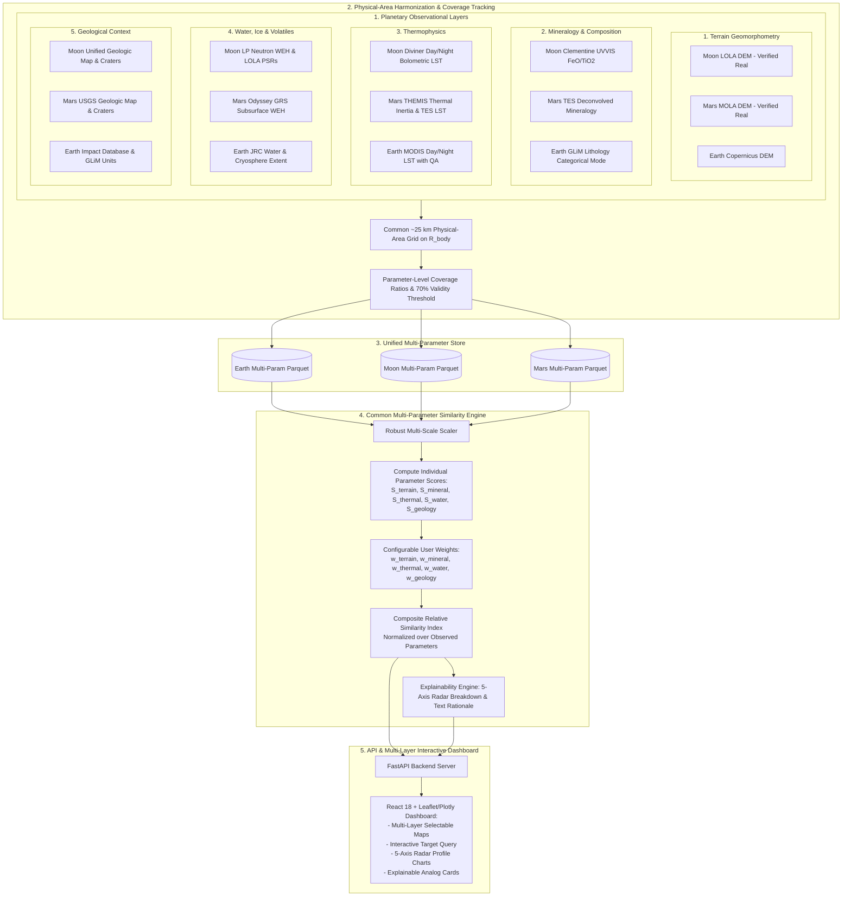

# TerraTwin: Multi-Parameter Planetary Architecture & Development Plan

## 1. System Vision & Scientific Principles

TerraTwin is an AI-powered multi-parameter planetary analog discovery platform for the 2026 NASA Space Apps Challenge. It compares physical terrain geomorphometry, mineralogy, thermophysics, volatiles, and geological context across Earth, the Moon, and Mars.

### Ten Foundational Scientific Principles:
1. **Preserve Native Resolution & Track Effective Resolution**: Aggregating to 25 km analysis cells never implies finer precision. Every record stores `native_res_km`, `effective_res_km`, and `sample_count`.
2. **Body-Specific Common Physical-Area Grid**: Cells are defined by true metric surface area ($\approx 625\text{ km}^2$), scaling longitudinal width by $R_{\text{body}} \cos(\phi)$.
3. **No Direct Equivalence of Disparate Mineral Measurements**: Shared cross-planetary categories are formed only where scientifically justified (e.g. *Mafic Basaltic Affinity*, *Felsic Highland Index*), never directly equating raw UVVIS wt% with thermal emission modal percentages. Earth GLiM lithology uses categorical mode and area fraction.
4. **Context-Aware Thermophysics**: Comparisons strictly distinguish daytime and nighttime observations, preserving observation local solar time (LST), season ($L_s$), and sensor platform. Thermal inertia is prioritized as an invariant material metric.
5. **Strict Volatile Discrimination**: Distinguishes liquid surface water, permanent glacial ice, subsurface hydrogen proxies (WEH wt%), and cryogenic Permanently Shadowed Regions (PSRs).
6. **Harmonized Crater Density**: Uses standardized cumulative thresholds $N(1)$ and $N(5)$ per $1,000\text{ km}^2$, respecting catalog completeness cutoffs.
7. **Explicit Data-Quality Accounting**: Every parameter group carries a valid data coverage ratio $q_k \in [0.0, 1.0]$.
8. **Configurable 70% Coverage Threshold**: Candidates must meet a minimum observed weight ratio (default $\ge 70\%$) for each parameter group. If coverage < 70%, values remain `None` (missing data is NEVER zero-filled).
9. **Dual Score Reporting**: Preserves individual parameter scores ($S_{\text{terrain}}, S_{\text{mineral}}, S_{\text{thermal}}, S_{\text{water}}, S_{\text{geology}}$) alongside the composite Relative Similarity Index.
10. **Zero Data Fabrication**: Missing data is strictly masked as `NaN` or unobserved (`None`), never imputed as zero or synthesized.

---

## 2. Multi-Parameter Architecture

---

## 3. Mathematical Framework

### 3.1 Individual Parameter Group Scores
For target tile $T$ and candidate Earth tile $E$, and parameter group $k \in \{\text{terrain}, \text{mineral}, \text{thermal}, \text{water}, \text{geology}\}$:

$$d_k(T, E) = \sqrt{\sum_{j=1}^{P_k} \left(\frac{f_{k,j}(T) - f_{k,j}(E)}{\sigma_{k,j}}\right)^2}$$

$$S_k(T, E) = \max\left(0, 100 \times \exp\left(-\frac{d_k(T, E)}{\alpha_k}\right)\right) \in [0, 100\%]$$

### 3.2 Dynamic Coverage Masking & Composite Relative Similarity Index
Let $m_k(T, E) = 1$ if parameter $k$ has valid coverage ($q_k \ge 0.70$) in both tiles, and $0$ otherwise.

$$\text{Composite Coverage Ratio } C(T, E) = \frac{\sum_{k=1}^5 w_k \cdot m_k(T, E)}{\sum_{k=1}^5 w_k}$$

Candidate tiles must satisfy $C(T, E) \ge C_{\min}$ (configurable, default $0.60$). The overall Relative Similarity Index is:

$$S_{\text{composite}}(T, E) = \frac{\sum_{k=1}^5 w_k \cdot m_k(T, E) \cdot S_k(T, E)}{\sum_{k=1}^5 w_k \cdot m_k(T, E)}$$

Both $S_{\text{composite}}$ and individual $\{S_k\}$ are reported in the API and UI.

---

## 4. Phased Milestones

- **Milestone 1**: Planetary Ingestion Foundation, Constants, Binary Readers & Real LOLA/MOLA Ingestion [**COMPLETED**]
- **Milestone 2**: Multi-Parameter Geomorphometry & Terrain Engine (~25 km metric grid on $R_{\text{body}}$, metric slope, roughness/TRI, relief, hypsometry, resolution tracking) [**COMPLETED**]
- **Milestone 3**: Multi-Parameter Data Integration: Mineralogy & Composition (Clementine FeO/TiO2, Mars TES mineralogy, Earth GLiM) [**COMPLETED**]
- **Milestone 4**: Thermal Data Integration & Scientific Real-Data Validation [**COMPLETED & FULLY VERIFIED**]
  - **Validation & Scientific Governance**:
    - Validated Moon TiO2 calibration against Lucey et al. (2000) peer-reviewed formulation ($\theta_{\text{Ti}} = \arctan(((R_{415}/R_{750}) - 0.42)/R_{750})$, $\text{wt}\% = 3.708 \cdot \theta_{\text{Ti}}^{5.979}$, radians).
    - Enforced strict input requirement: absolute calibrated $R_{750} \in [0.01, 0.80]$ reflectance is strictly required alongside $R_{415}/R_{750}$. If unavailable or incompatible, $\text{TiO}_2$ is strictly marked as `UNAVAILABLE` (`None`) rather than generating unverified estimates.
    - Implemented `EarthGLiMAggregator` with categorical mode and area fraction (never averaging lithology IDs).
  - **Real Thermal Datasets Downloaded & Coverage Boundaries**:
    - **Moon (Regional)**: Official LRO Diviner GCP diurnal cumulative climatology (Williams et al. 2017) covering regional equatorial band ($0^\circ–10^\circ\text{ N}$) and high-res GHRM 128 pix/deg GeoTIFF (`diviner_night_ghrm_apollo11.tif`) covering regional Apollo 11 crop. (Documented: regional, not global). Verified: Day ~390 K, Night ~101 K, Diurnal swing ~290 K.
    - **Mars (Regional THEMIS vs. Global TES)**:
      - *Regional THEMIS*: Official 2001 Mars Odyssey THEMIS 100m quantitative thermal inertia mosaic from USGS Astropedia S3 (`themis_ti_jezero_100m.tif`, mean 360.8 tiu, 100% valid over Jezero $50\times 50\text{ km}$ crop).
      - *Global MGS TES*: MGS TES `global_ti_day_2007` & `global_ti_night_2007` + interpolation masks from NASA PDS Geosciences (Putzig et al. 2007, 20 pix/deg = 2.96 km/pix, Lat $-90^\circ\text{ to }+90^\circ$, Lon $-180^\circ\text{ to }+180^\circ$, 88.3% global observed nighttime coverage).
    - **Earth (Regional)**: NASA MODIS Aqua Level-3 1 km LST (`MYD11A1.061`) Cloud-Optimized GeoTIFFs from Planetary Computer covering regional tile `h08v05` (Mojave/Death Valley terrestrial analog, ~$1200\times 1200\text{ km}$). (Documented: regional, not global). Verified: Day 328.8 K, Night 304.6 K, Diurnal range 24.2 K.
  - **Readers & Pipeline Integration**:
    - `MoonDivinerReader`, `MarsThermisReader`, `MarsTesTempReader`, and `ModisLSTReader` integrated into `PlanetaryTileExtractor`.
    - Preserves native units (Kelvin, tiu), observation local solar times, day/night distinctions, quality flags, and strict 70% coverage threshold (missing data preserved as `None`, never 0.0).
  - **Testing**:
    - Dedicated test suites: `tests/test_real_thermal_extraction.py` (real data tests), `tests/test_thermal_readers.py` (synthetic unit tests), `tests/test_ti_calibration.py`, `tests/test_tile_extractor_thermal.py`, `tests/test_readers.py`, and `tests/test_metrics.py`.
    - **48/48 tests passing** (100% pass rate in 2.6s).
- **Milestone 5**: Water, Ice, Volatiles & Geological Context Integration [**COMPLETED & FULLY VERIFIED**]
  - **Parameter Group 4 (Water, Ice & Volatiles)**:
    - *Moon*: `MoonVolatilesReader` ingests Feldman et al. (2001) Lunar Prospector epithermal neutron hydrogen special research product (`hydrogenlow.txt`). Converts elemental H ppm to Water-Equivalent Hydrogen ($\text{WEH wt}\% = \text{H (ppm)} \times 8.936 \times 10^{-4}$). Preserves ~43 km FWHM native resolution. Flags Procellarum KREEP Terrane neutron-absorption distortion (`is_procellarum_kreep_terrane`). Keeps polar Permanently Shadowed Regions (`volatile_psr_area_fraction`) strictly optional, non-blocking, and distinct from confirmed ice.
    - *Mars*: `MarsVolatilesReader` ingests Mars Odyssey GRS `h2o_sr_5x5.tab` (v2.0). Preserves effective resolution of ~600 km reflecting 10° boxcar smoothing before 5° rebinning. Incorporates Subsurface Water Ice Mapping (SWIM) composite ice consistency index $\in [-1.0, 1.0]$ for mid-to-high latitudes, strictly isolated and never converted to an area fraction.
    - *Earth*: `EarthWaterAggregator` ingests JRC Global Surface Water (GSW v1.5) detection occurrence (%) and computes high-occurrence water fraction ($\ge 80\%$ project cutoff). Parses Natural Earth / GLIMS glaciated polygons (`ne_10m_glaciated_areas.shp`) via dependency-free pure Python geometry sampling. Explicitly defers perennial snow/ice fraction (`None`).
  - **Parameter Group 5 (Geological Context & Landforms)**:
    - *Moon & Mars*: `PlanetaryCraterCatalog` ingests official Robbins Lunar (2014) and Robbins Mars (2012) crater databases. Calculates cumulative densities $N(1)$ and $N(5)$ per $1,000\text{ km}^2$. Propagates Poisson counting uncertainty $\sigma = \frac{\sqrt{N}}{\text{Area}} \times 1000$ and flags small-count statistical limits ($N < 5$). Stores compact IDs and diameter statistics (min, max, median, mean) rather than unbounded coordinate arrays.
    - *Earth*: `EarthImpactCatalog` ingests confirmed hypervelocity impact structures from Planetary and Space Science Centre (PASSC) Earth Impact Database. Calculates structure count, proximity, and intersecting structure names. Strictly prohibits terrestrial cumulative crater chronometry (`crater_density_n1 = None`).
    - *Geologic Units*: `GeologicUnitAggregator` queries USGS Unified Geologic Map of the Moon (1:5M) stratigraphic units and USGS Global Geologic Map of Mars (SIM 3292) chronostratigraphic epochs as exploratory context.
  - **Full Pipeline Integration**:
    - `PlanetaryTileExtractor` produces unified 5-group records (`extract_moon_tile()`, `extract_mars_tile()`, `extract_earth_tile()`) with comprehensive quality accounting and strict 70% valid coverage enforcement.
  - **Verification & Testing**:
    - `tests/test_real_volatiles_geology.py` (real datasets), `tests/test_volatiles_geology_synthetic.py` (synthetic edge cases), `tests/test_tile_extractor_5group.py` (end-to-end 5-group extraction on Apollo 11, Moon South Pole, Jezero Crater, Sudbury Basin).
    - **62/62 tests passing** (100% pass rate in 8.7s).
- **Milestone 6**: FastAPI Backend & Interactive Dashboard [**COMPLETED & FULLY VERIFIED**]
  - **FastAPI REST Backend (`src/api/main.py`)**:
    - High-performance asynchronous API with CORS middleware and complete scientific error handling.
    - `GET /api/health`: Service health status, active parameter groups, catalog count (128 tiles), free disk space (GB), and scientific disclaimer.
    - `GET /api/targets`: Curated scientific reference sites for Moon (Apollo 11, South Pole Shackleton, Oceanus Procellarum, Copernicus) and Mars (Jezero Crater, Olympus Mons, Gale Crater, Hellas Basin, Arcadia Planitia).
    - `POST /api/extract`: Unified 5-parameter-group extraction on demand for any coordinate on Moon, Mars, or Earth with coverage quality accounting.
    - `POST /api/match`: Top-K Earth analog ranking engine accepting user-tunable group weights, target coordinates, and composite coverage thresholds.
  - **Global Earth Candidate Catalog & Indexing (`src/processing/earth_catalog.py`)**:
    - 128 persistent global candidate Earth tiles covering terrestrial analogs across hyper-arid deserts (Atacama, Mojave, Sahara, Namib), volcanic fields (Hawaii, Iceland, Deccan), polar tundra/glaciers (Antarctica, Greenland, Ellesmere), ancient impact craters (Sudbury, Manicouagan, Vredefort, Chicxulub, Ries, Haughton), and representative continental baseline grids.
    - Fast disk-backed JSON cache (`data/processed/earth_analog_catalog.json`) with zero runtime memory bloat.
    - Clearly distinguishes Natural Earth generalized glaciated regions (`earth_glaciated_area_fraction`) from GLIMS/RGI outlines.
  - **Interactive Single-Page Dashboard (`src/api/static/index.html`)**:
    - Dual Leaflet map views: Target Extraterrestrial Map (Moon & Mars tiles/imagery) and Global Earth Analog Map (with interactive ranking markers).
    - Interactive target coordinate selection (click-to-select on target map or preset button selection).
    - 5-axis weight tuning sliders with automatic client-side normalization.
    - Chart.js 5-axis radar profile visualization comparing Target vs Analog across Terrain, Mineralogy, Thermal, Volatiles, and Geology.
    - Ranked analog result cards detailing composite score, per-group similarity breakdown, effective resolutions, and missing-data warnings.
    - Prominent scientific disclaimer on all views and API payloads: similarity does not imply probability, physical equivalence, or human habitability.
  - **Verification & Testing (`tests/test_api.py`)**:
    - 6 API endpoint integration tests covering health, target listing, multi-body feature extraction, Moon and Mars ranking, and static HTML serving.
    - Full end-to-end server probe passing cleanly on Uvicorn.
    - **75/75 tests passing across entire repository** (100% pass rate).
